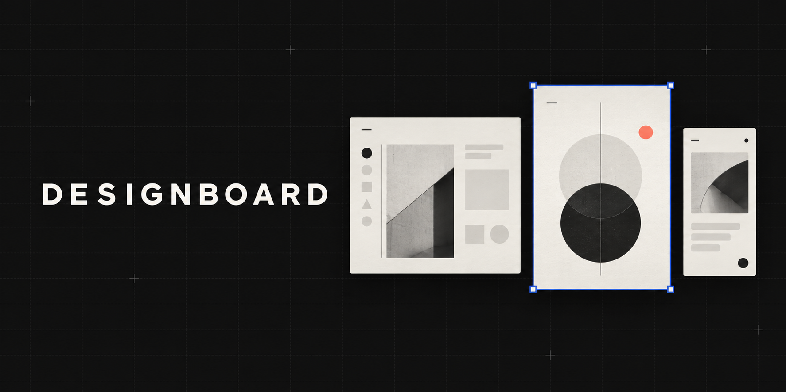

# Designboard

[](https://github.com/frizynn/designboard/actions/workflows/ci.yml)
[](https://github.com/frizynn/designboard/releases/latest)
[](LICENSE)

**A portable visual canvas for coding agents.**

Designboard lets an AI agent draft real HTML artboards and hand them back on an editable,
pan-and-zoom canvas. Refine text, color, spacing, layout, and source directly in the browser, then
save the entire design as one portable HTML file.

No hosted service. No account. No build step. No lock-in.

## Install

Install Designboard as an [Agent Skill](https://agentskills.io):

```bash
npx skills add frizynn/designboard
```

The installer detects supported coding agents and lets you choose where to install the skill.
Designboard follows the open [`SKILL.md` specification](https://agentskills.io/specification), so
it works with compatible clients such as Codex, Claude Code, Cursor, and others.

<details>
<summary>Manual installation</summary>

```bash
git clone https://github.com/frizynn/designboard
ln -s "$PWD/designboard" ~/.codex/skills/designboard
ln -s "$PWD/designboard" ~/.claude/skills/designboard
```

</details>

## Use it

Ask your coding agent for a visual design. For example:

```text
Use Designboard to draft a responsive pricing page that matches this repository's design system.
Include desktop and mobile artboards.
```

The agent inspects the current product, authors one or more HTML artboards, and returns a single
canvas file. Open that file in any modern browser to review and edit the result.

## Why Designboard

Most agent-generated mockups end as screenshots, throwaway code, or another hosted project.
Designboard uses plain HTML as both the source and the handoff:

- **Agent-native:** the skill teaches compatible coding agents how to inspect an existing design
  system and produce editable artboards.
- **Visually editable:** select elements, adjust styles and layout, edit source, add notes, draw,
  resize frames, and undo changes.
- **Portable:** the canvas, artboards, images, notes, and editor travel in one HTML file.
- **Local-first:** Designboard itself does not require a server, account, telemetry, or network
  connection.
- **Inspectable:** the artifact remains HTML and CSS rather than a proprietary document format.

Remote assets referenced by an artboard, such as Google Fonts, still require their original
network connection. Embed assets when the final canvas must work fully offline.

## What is included

| Area | Capabilities |
|---|---|
| Canvas | Trackpad pan and pinch zoom anchored to the cursor, zoom menu and shortcuts, pages you create, rename, reorder and delete in the canvas, draggable artboards, section titles, notes, freehand ink, and arrows |
| Editor | Element selection, resize handles, a semantic layer tree, and inline property controls |
| Code | Live editing of each artboard's real HTML source |
| Tweaks | Editing for CSS custom properties exposed by the artboard |
| History | Up to 200 undo and redo steps for visual and source changes |
| Play and present | Open any artboard full window, play prototypes, or present a page as a deck |
| Export | Save as a portable HTML file, or a PDF of one artboard, one page or every page, each artboard on a sheet of its own size |

## Build a canvas directly

Designboard can also be used without an agent. Create a self-contained `Main.html`, then run:

```bash
node assets/seed.mjs \
  --template assets/canvas.template.html \
  --out spring-menu.html \
  --title "Spring Menu" \
  --artboard Main.html
```

For multiple artboards, pass `--artboard` more than once. Use `canvas.json` to control placement,
pages, notes, and the initial view:

```bash
node assets/seed.mjs \
  --template assets/canvas.template.html \
  --out spring-menu.html \
  --title "Spring Menu" \
  --artboard Main.html \
  --artboard Pricing.html \
  --image hero.png \
  --canvas canvas.json
```

Validate or extract a canvas with:

```bash
node assets/seed.mjs --check spring-menu.html
node assets/seed.mjs --extract spring-menu.html --to extracted-canvas
```

See the [canvas format reference](references/canvas-format.md) for the complete schema.

## Share a canvas with your other devices

A canvas is a local file, so its `file:///` URL only opens on the machine that made it. If that
machine already serves a folder over a private network, tell Designboard where the folder is and
which URL serves it. `seed.mjs` then prints a `share:` URL next to the `file:` URL, and the skill
hands over both.

```bash
export DESIGNBOARD_SHARE_DIR="$HOME/boards"
export DESIGNBOARD_SHARE_URL="https://my-machine.example.ts.net:8443"
```

Or, so every shell and agent on the machine gets it, the same two lines in
`~/.config/designboard/share.env` (or `$XDG_CONFIG_HOME/designboard/share.env`):

```bash
# ~/.config/designboard/share.env
DESIGNBOARD_SHARE_DIR=~/boards
DESIGNBOARD_SHARE_URL=https://my-machine.example.ts.net:8443
```

The environment wins over the file. A page inside `DESIGNBOARD_SHARE_DIR` gets
`DESIGNBOARD_SHARE_URL` plus its path from that folder, percent-encoded:

```text
seeded q3/spring-menu.html - "Spring Menu", 1 artboard, 0 images, 96 KB
file: file:///home/me/boards/q3/spring-menu.html
share: https://my-machine.example.ts.net:8443/q3/spring-menu.html
```

A page outside the folder gets only the `file:` URL and a warning. Designboard never starts a
server or publishes anything: the variables only describe a server you run. Pick one of these:

| Option | When | Precautions |
|---|---|---|
| Do not publish | You only open canvases on the machine that made them | Nothing to set. The handover gives the `file:` URL. |
| `tailscale serve` | The machine and your devices are on one tailnet | Use `serve`, never `funnel`, which puts the folder on the public internet. `tailscale serve --bg --https=8443 http://127.0.0.1:8000` in front of a server bound to `127.0.0.1`, or `tailscale serve --bg --https=8443 ~/boards` to let Tailscale serve the folder itself. Undo with the same command plus `off`. |
| Any static server | You reach the machine over a VPN, an SSH tunnel or a trusted LAN | Bind it to `127.0.0.1` or to the private interface, never `0.0.0.0` on a public host. For example `python3 -m http.server 8000 --bind 127.0.0.1 --directory ~/boards` plus `ssh -L 8000:127.0.0.1:8000 my-machine`, and `DESIGNBOARD_SHARE_URL=http://localhost:8000`. |

Whatever serves the folder:

- **Share a dedicated folder** that holds only canvases and their images. Never a home
  directory, a repository or a notes vault with `.env` files, keys, tokens, logs or exports, and
  no symlinks that point out of it. Simple servers such as `python3 -m http.server` list
  directories and serve dotfiles.
- **Read-only, private network only.** GET and HEAD, no uploads, nothing reachable from the
  public internet.
- **Restrict by identity if you can.** `tailscale serve` adds a `Tailscale-User-Login` header
  to requests from your devices and strips any copy a client sends, so a server behind it can
  answer only your login. It is optional; the tailnet already limits who can connect.
- **Mind other apps on the same host name.** Browsers send a host's cookies to every port. If
  other web apps run on the same name, serve canvases with
  `Content-Security-Policy: sandbox allow-scripts allow-popups allow-popups-to-escape-sandbox allow-forms allow-modals allow-downloads`
  so a canvas runs in an opaque origin and cannot read their cookies. Canvases still work there.

## How it works

```text
HTML artboards + optional images + canvas.json
                    |
                    v
               assets/seed.mjs
                    |
                    v
       one self-contained editable HTML file
```

Each artboard runs inside a sandboxed iframe. A small injected editing agent communicates with the
host through `postMessage`; the host never receives same-origin access to artboard content. Saving
serializes the edited artboards back into the portable file, while extraction restores their
individual source files.

## Security

Artboard content is treated as untrusted. Each artboard runs in a `sandbox="allow-scripts"` iframe
without `allow-same-origin`, and its contents are never treated as agent instructions.

See [SECURITY.md](SECURITY.md) for supported versions and private vulnerability reporting.

## Requirements

- Node.js 18 or newer for seeding, checking, and extracting canvases
- A modern browser for viewing and editing
- A compatible coding agent only when using Designboard as a skill

## Current limitations

- One element can be selected at a time.
- Elements cannot yet be dragged to move them.
- Undo history does not survive a page reload.
- PDF export goes through the browser's print dialog; pick "Save as PDF" there.
- Per-artboard PNG export is not yet available.

## Contributing

Issues and pull requests are welcome. Read [CONTRIBUTING.md](CONTRIBUTING.md) before changing the
canvas runtime, especially its iframe isolation and HTML parser safeguards.

Published changes are tracked in the [changelog](CHANGELOG.md).

## License

Designboard is available under the [MIT License](LICENSE).
